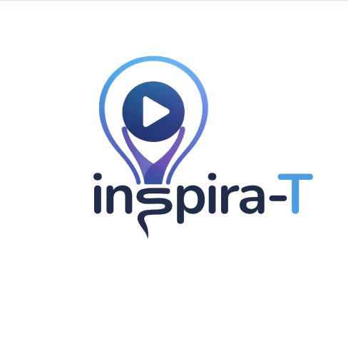
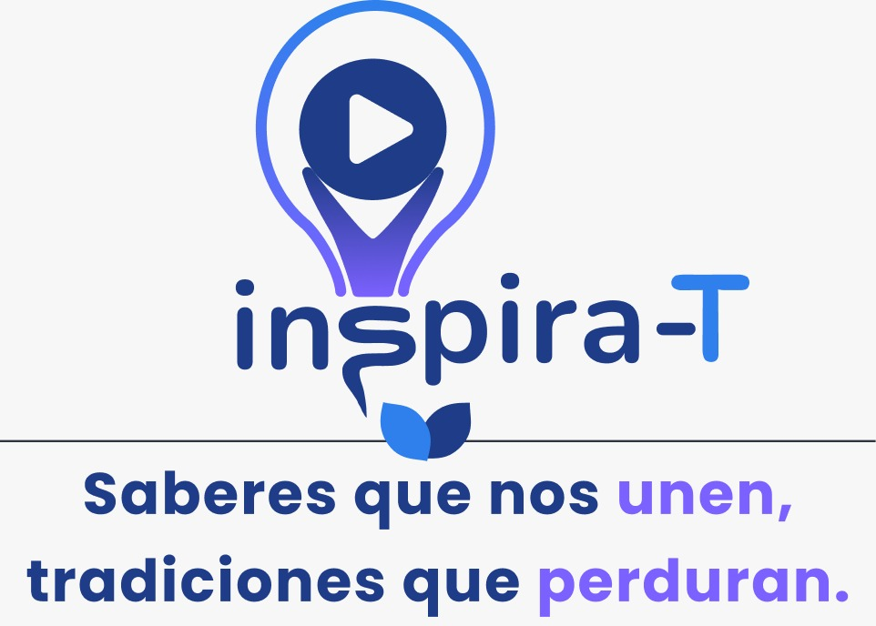

# inspira-T

<div align="center">


<br><br>





</div>

---

<div align="center">


-lightgrey)


</div>

---

## Índice

- [inspira-T](#inspira-T)
  - [Índice](#índice)
- [Descripción general](#descripción-general)
- [Empresa desarrolladora](#empresa-desarrolladora)
  - [inspira-T Development Team](#inspira-T-development-team)
  - [Propósito de inspira-T](#propósito-de-inspira-T)
- [Identidad del software](#identidad-del-software)
  - [Nombre del software](#nombre-del-software)
  - [Nombre completo del proyecto](#nombre-completo-del-proyecto)
  - [Siglas sugeridas](#siglas-sugeridas)
  - [Descripción de la identidad](#descripción-de-la-identidad)
  - [Paleta de colores sugerida](#paleta-de-colores-sugerida)
- [Contexto del proyecto](#contexto-del-proyecto)
- [Planteamiento del problema](#planteamiento-del-problema)
- [Propuesta de solución](#propuesta-de-solución)
  - [Beneficios esperados](#beneficios-esperados)
- [Objetivo general](#objetivo-general)
- [Objetivos específicos](#objetivos-específicos)
- [Alcance general](#alcance-general)
- [Módulos principales](#módulos-principales)
  - [Módulo de autenticación y usuarios](#módulo-de-autenticación-y-usuarios)
  - [Módulo de gestión de perfiles](#módulo-de-gestión-de-perfiles)
  - [Módulo de explorar contenido](#módulo-de-explorar-contenido)
  - [Módulo de gestión de cursos](#módulo-de-gestión-de-cursos)
  - [Módulo de reproducción de contenido](#módulo-de-reproducción-de-contenido)
  - [Módulo de mi aprendizaje](#módulo-de-mi-aprendizaje)
  - [Módulo de transmisiones en vivo](#módulo-de-transmisiones-en-vivo)
  - [Módulo de interacción y comentarios](#módulo-de-interacción-y-comentarios)
  - [Módulo de notificaciones](#módulo-de-notificaciones)
  - [Módulo de información](#módulo-de-información)
- [Reglas de negocio](#reglas-de-negocio)
  - [1. Tipos de usuario](#1-tipos-de-usuario)
  - [2. Registro de usuarios](#2-registro-de-usuarios)
  - [3. Autenticación](#3-autenticación)
  - [4. Permisos según el tipo de usuario](#4-permisos-según-el-tipo-de-usuario)
  - [5. Creación de cursos](#5-creación-de-cursos)
  - [6. Publicación de cursos](#6-publicación-de-cursos)
  - [7. Categorías de contenido](#7-categorías-de-contenido)
  - [8. Inscripción](#8-inscripción)
  - [9. Seguimiento del progreso](#9-seguimiento-del-progreso)
  - [10. Contenido público y privado](#10-contenido-público-y-privado)
  - [11. Transmisiones en vivo](#11-transmisiones-en-vivo)
  - [12. Comentarios](#12-comentarios)
  - [13. Notificaciones](#13-notificaciones)
  - [14. Perfil](#14-perfil)
- [Estructura documental del repositorio](#estructura-documental-del-repositorio)
  - [Documentación principal](#documentación-principal)
- [Documentos específicos por subcarpeta](#documentos-específicos-por-subcarpeta)
  - [`docs/01-contexto/`](#docs01-contexto)
  - [`docs/02-analisis/`](#docs02-analisis)
    - [TABLA DE COLABORADORES](#tabla-de-colaboradores)

---

# Descripción general

Inspira-T es un sistema de escritorio orientado al aprendizaje, difusión y preservación de los saberes, tradiciones y expresiones culturales mexicanas. El proyecto busca proporcionar un espacio digital donde los usuarios puedan acceder a contenidos educativos relacionados con temas como artesanías, gastronomía tradicional, lenguas indígenas, medicina tradicional, agricultura, música, danza y otras manifestaciones culturales.

El sistema contempla dos tipos principales de usuarios: Aprendientes e Instructores. Los Aprendientes podrán explorar y buscar contenidos, inscribirse en cursos, reproducir videos, consultar transmisiones en vivo, dar seguimiento a su progreso e interactuar mediante comentarios. Por su parte, los Instructores podrán crear, administrar y publicar contenidos educativos, incluyendo cursos grabados y transmisiones en vivo.

Inspira-T también busca facilitar una experiencia de aprendizaje organizada mediante funcionalidades como la exploración de contenidos, categorías, seguimiento del progreso, recomendaciones, notificaciones y perfiles de usuario. 

Desde el punto de vista tecnológico, el proyecto pertenece al sector de Tecnologías de la Información y Comunicación (TIC), específicamente al desarrollo de software, y tiene como ámbito de aplicación la educación y preservación cultural. Su desarrollo contempla el uso de una interfaz gráfica de escritorio, programación orientada a objetos y una base de datos para gestionar usuarios, cursos, contenidos, inscripciones y demás información necesaria para el funcionamiento del sistema.

En conjunto, Inspira-T pretende combinar tecnología y educación para acercar a los usuarios al patrimonio cultural mexicano, proporcionando una herramienta accesible y organizada para aprender, compartir y contribuir a la conservación de conocimientos y tradiciones.

---

# Empresa desarrolladora

<div align="center">


</div>

## Inspira-T Development Team

**Inspira-T Development Team** es un equipo de desarrollo de software conformado por cinco estudiantes de primer año de la carrera de Técnico Superior Universitario (T.S.U.) en Desarrollo de Software.

## Propósito de inspira-T

El equipo tiene como propósito aplicar los conocimientos adquiridos durante la formación académica en el análisis, diseño, desarrollo y documentación de soluciones de software. 
Como parte de este proyecto académico, el equipo desarrolla **inspira-T**, un sistema de escritorio orientado al aprendizaje, difusión y preservación de los saberes y tradiciones culturales mexicanas. Para su desarrollo se integran actividades de las materias: Proyecto integrador, Base de datos, Programación Orientada a Objetos y Tópicos de Calidad.

---

# Identidad del software

<div align="center">


<br><br>


</div>

## Nombre del software

**inspira-T**

## Nombre completo del proyecto

**inspira-T "Saberes que nos unen, tradiciones que perduran**

## Siglas sugeridas

**inspira-T**

## Descripción de la identidad

La identidad gráfica de **inspira-T** integra elementos visuales relacionados con:

- Instructores.
- Aprendientes.
- Cursos.
- Explorar categorías.
- Transmisiones en vivo.
- Perfil de usuario.
- Aprendizaje.

Su diseño busca transmitir confianza, organización, profesionalismo e interacción y claridad.

## Paleta de colores sugerida

| Color | Uso sugerido | Significado |
|---|---|---|
| Azul tecnológico | Color primario | Innovación, educación digital, confianza y conocimiento.  |
| Azul confianza | Color secundario institucional | Estabilidad, experiencia, profesionalismo y credibilidad |
| Morado innovación | Color de acento | Creatividad, imaginación, transformación digital y aprendizaje |
| Turquesa comunidad | Color de éxito y apoyo | Colaboración, crecimiento, sostenibilidad y comunidad |
| Gris grafito | Texto principal | Elegancia, equilibrio y legibilidad |
| Blanco pureza | Fondos | Claridad, simplicidad, accesibilidad y orden |

---

# Contexto del proyecto

Actualmente, gran parte de conocimientos culturales y tradicionales son transmitidos principalmente mediante la convivencia y la enseñanza directa entre generaciones, por lo que resulta importante contar con alternativas digitales que permitan documentarlos y acercarlos a nuevos usuarios.

Dentro de este contexto, se propone el desarrollo de Inspira-T, un sistema de escritorio educativo que permita reunir y organizar contenidos relacionados con diferentes expresiones culturales, como lenguas indígenas, gastronomía tradicional, artesanías, agricultura, medicina tradicional, música, danza, deportes y juegos tradicionales, entre otros.

El proyecto se encuentra dentro del sector de Tecnologías de la Información y Comunicación (TIC), específicamente en el desarrollo de software, teniendo como ámbito de aplicación la educación y la preservación cultural. Su finalidad es demostrar cómo una solución tecnológica puede utilizarse para crear una experiencia de aprendizaje organizada y accesible, al mismo tiempo que contribuye a mantener presentes los conocimientos y tradiciones culturales.

---

# Planteamiento del problema

México posee una gran riqueza cultural representada por sus pueblos indígenas y comunidades tradicionales. Sin embargo, gran parte de sus conocimientos, lenguas y prácticas ancestrales se encuentran en riesgo de desaparecer debido a factores como la globalización, la migración, el envejecimiento de las personas que poseen estos saberes y la falta de espacios accesibles para transmitirlos a nuevas generaciones. 
Actualmente existen pocas plataformas digitales que permitan a estas personas compartir sus conocimientos de forma sencilla. Como consecuencia, muchos saberes tradicionales se pierden con el paso del tiempo. Por ello surge la necesidad de crear un programa digital que facilite la enseñanza, difusión y preservación de estos conocimientos, conectando a quienes desean aprender con quienes desean compartir su cultura.

---

# Propuesta de solución

Se propone desarrollar **inspira-T**, un sistema de escritorio educativo que centralice y organice contenidos relacionados con los saberes, tradiciones y expresiones culturales mexicanas en un solo entorno digital.

La solución permitirá que los usuarios puedan explorar, consultar y dar seguimiento a contenidos educativos de diferentes categorías culturales, utilizando principalmente recursos audiovisuales y actividades de aprendizaje. De esta manera, se busca facilitar el acceso a información cultural y ofrecer una alternativa tecnológica para apoyar la transmisión de conocimientos entre generaciones..

## Beneficios esperados

- Facilitar acceso al conocimiento cultural.
- Promover aprendizaje de tradiciones mexicanas.
- Contribuir a la preservación de saberes culturales.
- Centralizar diferentes tipos de contenidos.
- Ofrecer diferentes tipos de contenidos.
- Mejorar la experiencia de aprendizaje.
- Permitir seguimiento a proceso de aprendizaje.
- Promover el uso de tecnología para la educación y difusión cultural.

---

# Objetivo general

Desarrollar un ejecutable de escritorio que permita preservar, difundir y transmitir conocimientos, técnicas y tradiciones ancestrales y culturales de México, mediante la conexión entre expertos culturales y personas interesadas en aprender.

---

# Objetivos específicos

1. Investigar las necesidades de los usuarios y estructurar los requerimientos del sistema mediante la metodología Design Thinking, identificando las problemáticas relacionadas con la conservación y difusión de conocimientos y habilidades .

2. Identificar y seleccionar los ODS a los que contribuye el proyecto.

3. Clasificar el contenido del ejecutable por categorías de conocimiento.

4. Promover la conservación y difusión de conocimientos tradicionales, 
ancestrales y habilidades prácticas mediante un ejecutable accesible e 
interactivo.

5. Diseñar y desarrollar una BD organizada y accesible.

6. Desarrollar los modelos de análisis y diseño del ejecutable. Incluyendo los diagramas de casos de uso, modelos de E-R y Relacional de la BD.

7. Crear un repositorio de control de versiones para el proyecto y gestionar los cambios realizados durante el desarrollo del ejecutable.

8. Desarrollar las interfaces en Java e implementar el flujo de navegación entre las diferentes pantallas del ejecutable.

9. Estructurar y elaborar la documentación del proyecto, integrando el análisis, diseño, desarrollo y resultados obtenidos. 

---

# Alcance general

El sistema contempla la gestión básica de los siguientes procesos:

| Área | Descripción general |
|---|---|
| Usuarios | Registro y administración de información básica de usuarios |
| Gestión de aprendientes | Consulta de cursos y seguimiento de aprendizaje |
| Gestión de instructores | Crear, publicar contenidos educativos |
| Cursos y contenidos | Catálogo de cursos y contenidos relacionados |
| Transmisiones en vivo | Configuración y publicación de sesiones |
| Reproducción | Acceso y seguimiento a videos educativos|
| Comentarios | Participación de aprendientes |
| Notificaciones | Información relevante |
| Categorías | Clasificación de contenidos por áreas |

---

# Módulos principales

## Módulo de autenticación y usuarios

Permitirá registrar, iniciar sesión, recuperar contraseña y gestionar cuentas.

## Módulo de gestión de perfiles

Administración de la información de aprendientes e instructores.

## Módulo de explorar contenido

Permite consultar y buscar cursos y contenidos culturales disponibles.

## Módulo de gestión de cursos

Permite a los instructores crear, editar, publicar y administrar cursos.

## Módulo de reproducción de contenido

Permite visualizar videos y acceder al contenido de los cursos.

## Módulo de mi aprendizaje

Registra cursos inscritos y el progreso del aprendiente.

## Módulo de pagos

Permitirá registrar anticipos, pagos completos, adeudos y métodos de pago.

## Módulo de transmisiones en vivo

Permite gestionar y consultar clases o sesiones transmitidas en vivo.

## Módulo de interacción y comentarios

Permite realizar comentarios, opiniones y preguntas sobre los contenidos.

## Módulo de notificaciones

Informa sobre nuevos cursos, transmisiones y actividades relevantes.

## Módulo de información

Administración de información, usuarios, contenidos y datos generales del sistema.

---

# Reglas de negocio

Las siguientes reglas de negocio establecen las condiciones, restricciones y validaciones que el sistema debe cumplir para garantizar la consistencia e integridad de la operación de inspira-T. Están organizadas por módulo funcional.

## 1. Tipos de usuario

- **RN-01**: El sistema manejará únicamente dos tipos de usuario: aprendiente e instructor.

## 2. Registro de usuarios

- **RN-02**: Todo usuario deberá proporcionar la información requerida para crear una cuenta y utilizar las funciones correspondientes a su tipo de usuario.

## 3. Autenticación

- **RN-03**: El usuario deberá iniciar sesión con sus credenciales registradas para acceder a las funciones privadas del sistema.

## 4. Permisos según el tipo de usuario

- **RN-04**: El sistema deberá limitar las funciones disponibles de acuerdo con el tipo de usuario. Por ejemplo:
	El Aprendiente puede inscribirse y consumir cursos.
	El Instructor puede crear y administrar cursos.

## 5. Creación de cursos

- **RN-05**: Solamente los Instructores podrán crear y administrar contenido educativo.

## 6. Publicación de cursos

- **RN-06**: Un curso no podrá publicarse si no cuenta con la información obligatoria, como: título, categoría, descripción, contenido, miniatura, información necesaria del curso.

## 7. Categorías de contenido

- **RN-07**: Los cursos deberán pertenecer a una categoría cultural previamente definida, por ejemplo:
	Agricultura tradicional
	Artesanías
	Gastronomía
	Lenguas
	Medicina tradicional
	Deportes y juegos

## 8. Inscripción

- **RN-08**: Un Aprendiente podrá inscribirse a los cursos disponibles para su aprendizaje.

- **RN-09**: Una vez realizada la inscripción, el curso deberá aparecer dentro de Mi aprendizaje / Mis cursos.

## 9. Seguimiento del progreso

- **RN-10**: El sistema deberá conservar el progreso del Aprendiente para permitirle continuar posteriormente desde el punto donde dejó el contenido.

## 10. Contenido público y privado

- **RN-11**: El Instructor podrá establecer la visibilidad de su contenido, por ejemplo:
	Público: cualquier usuario puede acceder.
	No listado: solamente usuarios que tengan acceso al enlace.
	Privado: únicamente el Instructor puede visualizarlo.

## 11. Transmisiones en vivo

- **RN-12**: Las transmisiones deberán contener información necesaria como: título, categoría, descripción, fecha, hora, duración estimada, nivel de dificultad.

## 12. Comentarios

- **RN-13**: Los Aprendientes podrán realizar comentarios o preguntas en contenidos que permitan esta función.

- **RN-14**: El Instructor podrá consultar dichas interacciones.

## 13. Notificaciones

- **RN-15**: El sistema podrá generar notificaciones relacionadas con: nuevos cursos, transmisiones en vivo, recordatorios de aprendizaje, actualizaciones relevantes.

## 14. Perfil

- **RN-16**: Los contenidos publicados deberán estar asociados a un Instructor responsable de su creación.

- **RN-17**: Los usuarios aprendientes podrán visualizar y actualizar su información personal.

---

# Estructura documental del repositorio

Este README funciona como documento principal de presentación del proyecto.

Los documentos específicos como requerimientos funcionales, requerimientos no funcionales, reglas de negocio, base de datos, casos de uso, pruebas y manuales se encuentran organizados en subcarpetas dentro de `Documentation/`.

## Documentación principal

| Carpeta | Contenido | Descripción |
|---|---|---|
| [`docs/01-contexto/`](./docs/01-contexto/) | Contexto, problema y justificación | Documentos que explican el origen y necesidad del proyecto |
| [`docs/02-analisis/`](./docs/02-analisis/) | Requerimientos, reglas de negocio e historias de usuario | Documentación del análisis funcional del sistema |
| [`docs/03-diseno/`](./docs/03-diseno/) | Arquitectura, interfaces y diagramas | Diseño general del sistema |
| [`docs/04-base-datos/`](./docs/04-base-datos/) | Modelo de datos, diccionario y scripts | Documentación relacionada con la base de datos |
| [`docs/05-desarrollo/`](./docs/05-desarrollo/) | Configuración, estructura técnica y convenciones | Información para desarrolladores |
| [`docs/06-pruebas/`](./docs/06-pruebas/) | Plan de pruebas y evidencias | Validación del funcionamiento del sistema |
| [`docs/07-manuales/`](./docs/07-manuales/) | Manual técnico y manual de usuario | Guías de instalación, operación y mantenimiento |
| [`docs/08-gestion-proyecto/`](./docs/08-gestion-proyecto/) | Cronograma, roles y control de cambios | Seguimiento administrativo del proyecto |
| [`docs/09-evidencias/`](./docs/09-evidencias/) | Capturas, prototipos y avances | Evidencias visuales del desarrollo |
| [`docs/assets/`](./docs/assets/) | Imágenes y recursos gráficos | Logos, capturas y diagramas auxiliares |

---

# Documentos específicos por subcarpeta

## `docs/01-contexto/`

Documentos sugeridos:

```txt
contexto-del-proyecto.md
planteamiento-del-problema.md
justificacion.md
propuesta-de-solucion.md
objetivos.md
alcances-limitaciones.md
```

## `docs/02-analisis/`

Documentos sugeridos:

```txt
requerimientos-funcionales.md
requerimientos-no-funcionales.md
reglas-de-negocio.md
historias-de-usuario.md
casos-de-uso.md
```

### TABLA DE COLABORADORES

| Nombre                        | Usuario                | Puesto | Ultima acción|
|-------------------------------|------------------------|--------|--------------|
| Carlos Eduardo Antonio Álvarez|  [charles-antt](https://github.com/charles-antt)       | Líder de Proyecto        | Creación del Readme.md principal del proyecto
| Bertha Hernández Aranda  | [251113-BerthaHernandezAranda](https://github.com/251113-BerthaHernandezAranda)       | Líder de Desarrollo   | Creación de la documentación del código creando clase por clase |
| Alma Ariadne Maldonado Eslava | [251028-aame](https://github.com/251028)        | Administradora de Base de Datos         | Carga de los modelo de entidad E-R y modelo relacional, los scripts de la creación de la base de datos y el modelado de llenado y el llenado de Datos | 
| Jesús Yahir Calderón López  | [250802-eng](https://github.com/250802-eng)        | Diseñador de UX/UI      |Se agregaron los bocetos de la pantalla de inicio y los wireframes de las pantallas del Sistema de Gestión de Talleres |
| Yair Sampayo Viveros  | [250943-cmd](https://github.com/250943-cmd)        | Diseñador UX/UI       | Se agregaron los Mockups y los prototipos de alta fidelidad del Sistema |
| M.T.I. Marco A. Ramírez Hdez  | [MTI-MarcoRH](https://github.com/MTI-MarcoRH)        | Cliente        |


